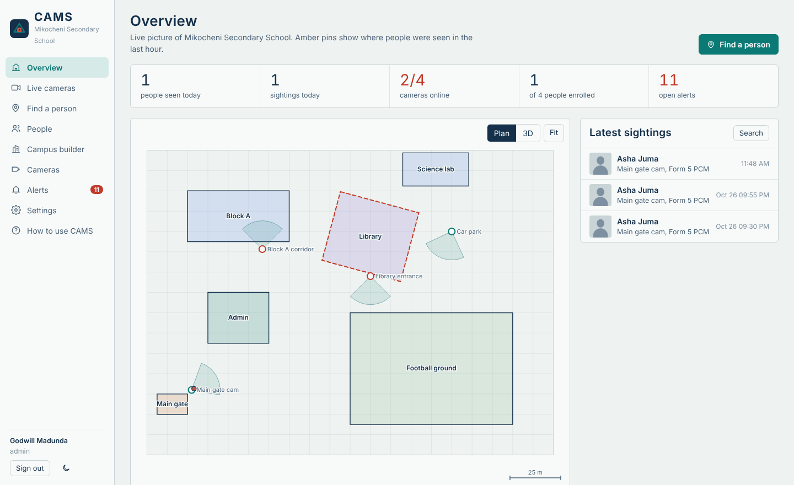
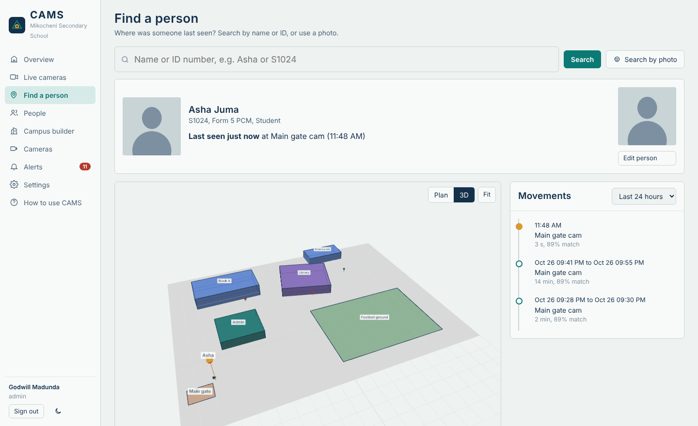
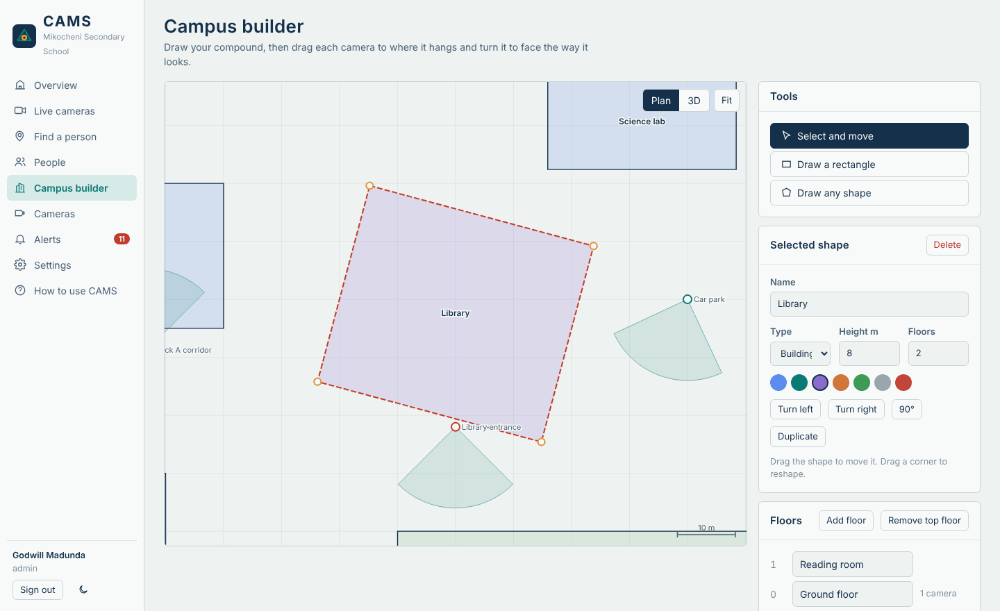
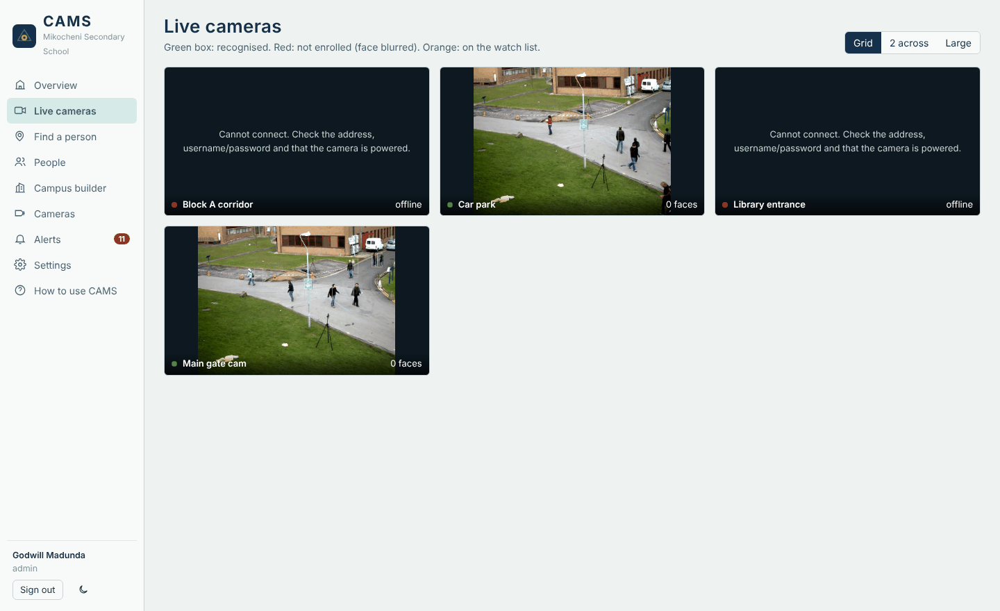
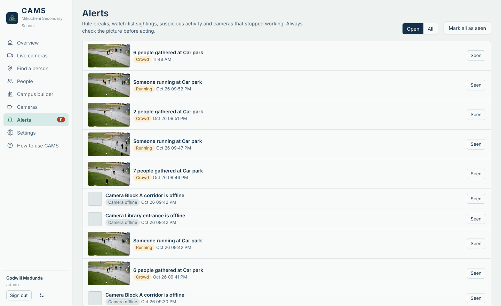
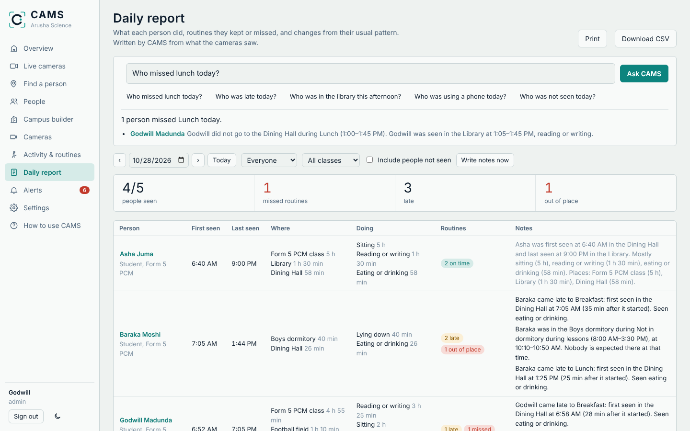
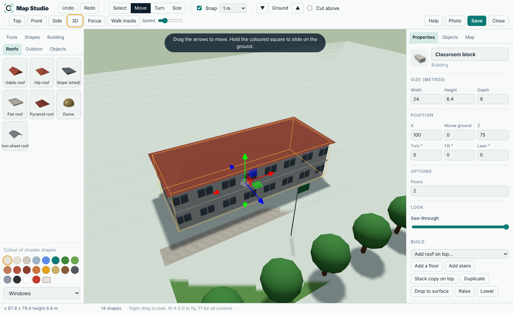
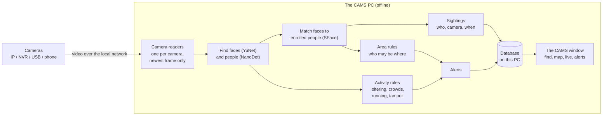

<p align="center">
  
</p>

<p align="center">
  <b>Type a name. See where that person was last seen on your campus.</b><br>
  CAMS turns the cameras on a school or company compound into a search, on one Windows PC, fully offline.
</p>

<p align="center">
  <a href="https://transittechdo-coder.github.io/CAMS/"><b>Website</b></a> ·
  <a href="https://github.com/transittechdo-coder/CAMS/releases/latest/download/CAMS-Setup.exe"><b>Download for Windows</b></a> ·
  <a href="docs/USER_GUIDE.md">User guide</a> ·
  <a href="docs/PRIVACY.md">Privacy guide</a>
</p>

<p align="center">
  <a href="https://github.com/transittechdo-coder/CAMS/actions/workflows/build-windows.yml"></a>
  <a href="https://github.com/transittechdo-coder/CAMS/releases/latest"></a>
</p>



CAMS is a collaboration between **TransitTech** and **Godwill Andrew Madunda**.

---

## Contents

1. [What CAMS does](#what-cams-does)
2. [Install and start](#install-and-start)
3. [Using CAMS, step by step](#using-cams-step-by-step)
4. [How it works](#how-it-works)
5. [Privacy and fair use](#privacy-and-fair-use)
6. [For developers](#for-developers)
7. [Questions and problems](#questions-and-problems)
8. [Licence](#licence)

---

## What CAMS does

Enrol a person's face once. From then on, whenever any camera on the campus sees them, CAMS
writes down **who, which camera and when**. A guard can type a name and see where that person
was last seen, their path on a 2D or 3D map of the campus, and a timeline of their day.

| | |
| --- | --- |
| **Find a person** | Search by name, ID number or photo. Shows last seen place and time, the path on the map and a timeline (today, 24 hours, 7 or 30 days). |
| **Any camera** | IP, Ethernet/PoE and NVR cameras (Hikvision, Dahua, Uniview, TP-Link, Reolink, Axis, EZVIZ, any ONVIF), HTTP/MJPEG cameras, phones, USB webcams. Address helper, connection test, network scan, auto-reconnect. |
| **Faces from every side** | Nine views per person: front, half left, left, half right, right, up, down, back, top. Webcam wizard, any CAMS camera, photos, or a turn-around video. |
| **Campus builder** | Draw buildings, gates, fields, parking and zones on a plan or satellite picture. Turn, move and copy them, add and name floors, place and aim every camera. |
| **3D Map Studio** | Draw the campus in 3D like a game level editor: free fly camera and walk mode, 50+ shapes, buildings with floors, rooms, walls with doors and windows, stairs, ladders, self-fitting roofs, stacking, floor-by-floor cut view, ground paint, tree and path brushes, undo, export. |
| **Activity timeline** | An on-device AI (body pose + objects + movement + place) writes what every recognised person is doing into their profile: eating, sitting, walking, reading, using a phone, playing sport... Teach it your own activities from example pictures, add place & time rules. |
| **Routines & daily report** | Set where people should be (Lunch in the dining hall 13:00–13:45). CAMS notes who kept it, came late or missed it and where they were instead, learns each person's usual pattern, flags changes, and writes a daily report (print / CSV). **Ask CAMS** answers questions like *Who missed lunch today?* offline. |
| **Real satellite map** | Find your compound on a world satellite map and use it as the campus map (internet needed once, then offline). Every camera and sighting gets an exact GPS position you can copy into Google Maps. |
| **Routes with video** | A person's movements are drawn as a line from building to building with direction arrows and numbered stops, each with a small picture and a short video clip of the moment they were seen. |
| **Recording** | Record any camera with one button, or all the time. Play recordings inside CAMS, download them as .mp4, or download just a part (camera + time from / to). Old videos delete themselves. |
| **Colour at night** | Black-and-white (infrared) CCTV video is coloured live by an on-device AI, per camera: automatic at night or always. Dark pictures are made clearer. Coloured video is marked *AI colour*, because the colours are a guess. |
| **Hologram 3D view** | One button turns the 3D campus into a see-through hologram: glass walls with glowing edges on a dark blueprint grid, with a compass, so every room, stair and camera inside the buildings is visible. |
| **Your mouse** | Choose which mouse button moves the map: swap left and right in Settings. |
| **Restricted areas** | Per building or zone: only some people may enter (by type, class or name), or some may not, and closed hours. |
| **Unusual situations** | A person-detection AI flags loitering, crowds, running, people present during closed hours, and cameras that are covered, blurred or turned away. |
| **Alerts** | Rule breaks, watch-list people, strangers on restricted cameras, unusual situations and offline cameras, each with a picture. |
| **Privacy** | Strangers are blurred, consent is recorded, old records delete themselves, one button erases a person, roles and an activity log. Nothing leaves the PC. |

<table>
  <tr>
    <td width="50%"><br><sub><b>Find a person</b>: last seen, 3D map and movements</sub></td>
    <td width="50%"><br><sub><b>Campus builder</b>: buildings, floors, cameras and who may enter</sub></td>
  </tr>
  <tr>
    <td width="50%"><br><sub><b>Live cameras</b> with online and offline status</sub></td>
    <td width="50%"><br><sub><b>Alerts</b> for crowds, running and offline cameras</sub></td>
  </tr>
  <tr>
    <td colspan="2"><br><sub><b>Daily report and Ask CAMS</b>: routines kept, late or missed, with written notes</sub></td>
  </tr>
  <tr>
    <td colspan="2"><br><sub><b>3D Map Studio</b>: draw buildings, roofs, floors, stairs and trees, then fly or walk through them</sub></td>
  </tr>
</table>

---

## Install and start

1. **Download** [CAMS-Setup.exe](https://github.com/transittechdo-coder/CAMS/releases/latest/download/CAMS-Setup.exe) (about 95 MB).
2. **Double-click it** and press **Next** until it finishes. No administrator password is needed;
   CAMS installs for you, like Scratch or Zoom.
3. **CAMS opens by itself.** From then on, double-click the **CAMS** icon on your desktop (or
   find CAMS in the Start menu). A CAMS loading picture appears at once, then the CAMS window.

The first time, CAMS asks for your school or company's name and creates your admin sign-in.

> Windows may say *"Windows protected your PC"* because the installer is new and not code-signed.
> Click **More info**, then **Run anyway**.

**What you need:** Windows 10 or 11 (64-bit), a 4-core processor (Core i5 / Ryzen 5 or better),
8 GB RAM, about 400 MB of disk. No graphics card and no internet are needed. One such PC handles
about 8 to 12 cameras at the default speed.

**Updating:** download the newest CAMS-Setup.exe and run it. Your people, cameras and settings
are kept (they live in `%APPDATA%\CAMS`).

---

## Using CAMS, step by step

The full guide with pictures is in [docs/USER_GUIDE.md](docs/USER_GUIDE.md) and inside CAMS under
**How to use CAMS**. In short:

1. **Add cameras** (Cameras page). Choose the brand, type the IP address, username and password,
   press **Test connection**. Or press **Find on network**. A USB webcam is `0`.
2. **Draw the campus** (Campus builder). Add a plan or satellite picture if you have one, draw each
   building, set its floors, then click each camera onto the map and aim it.
3. **Set the rules** (optional). On a building or zone, choose *Who may enter*. On a camera, press
   **Activity rules** for loitering, crowds, running, closed hours and tampering.
4. **Add people** (People page). One by one, or import your class list as a CSV with the columns
   `full_name, person_code, category, group_name`. Record consent.
5. **Capture faces.** Open a person, press **Capture face** and follow the nine views.
6. **Find people** (Find a person). Type a name or ID; see where and when they were last seen.

---

## How it works

Everything runs on one Windows PC. Cameras send video to it over the local network; nothing is
sent to the internet.



**1. Reading the cameras.** Each camera gets its own reader that keeps only the newest picture and
reconnects by itself if the network drops. RTSP is read over TCP, which gives fewer broken frames
on busy school networks.

**2. Finding faces and people.** A few times a second per camera (you choose how often), CAMS looks
at the newest picture with two small AI models:
- **YuNet** finds faces and five points on each face (eyes, nose, mouth corners). The points also
  tell which way the head is turned, which the enrolment wizard uses.
- **NanoDet-Plus** finds whole people, even with their back to the camera, for the activity rules.

**3. Recognising faces.** **SFace** turns each face into a *face print*: a list of 128 numbers.
Prints of the same person point in nearly the same direction, so CAMS compares them by angle
(cosine similarity). A face counts as a match only above the threshold you set (0.40 by default);
otherwise it is a stranger, and strangers are blurred.

**4. Sightings.** Seeing someone 50 times as they walk past makes **one** sighting with a start and
end time, not 50 rows. "Last seen", the timeline and the map path are built from these.

**5. Rules and alerts.** Each sighting is checked against the rules of the building or zone the
camera watches (allowed people, not-allowed people, closed hours). Separately, a tracker follows
each detected person between frames to spot loitering, crowds and running, and a picture check
notices covered, blurred or turned cameras. Every alert is saved with a picture.

**6. The window.** The CAMS window shows the screens. Behind it is a small private web server that
only this PC can reach (`127.0.0.1`), so no administrator rights are needed. The window uses
Microsoft Edge WebView2; if that is missing, CAMS opens Edge or Chrome in app mode (no address bar).

**What is stored, and where:** everything is in `%APPDATA%\CAMS` on the CAMS PC: one database file
(people, face prints, cameras, map, sightings, alerts, activity log), the enrolment pictures, small
face pictures with sightings, and the map picture. Sightings and their pictures are deleted
automatically after the number of days set in Settings (30 by default).

**The models** (bundled in the installer, about 43 MB in total) come from the
[OpenCV model zoo](https://github.com/opencv/opencv_zoo): YuNet (face detection), SFace (face
recognition) and NanoDet-Plus (person detection, trained on COCO). They run on the processor
through OpenCV, with no graphics card.

---

## Privacy and fair use

Face recognition handles sensitive personal data. CAMS gives you the tools to use it lawfully; the
school or company running it is responsible for doing so.

- **Consent first.** Record written consent for each person; for students under 18, from a parent
  or guardian. Put up signs saying cameras with face recognition are in use.
- **Strangers stay anonymous.** People who are not enrolled are blurred in the live view and in
  saved pictures.
- **Keep only what you need.** Set how many days sightings are kept; erase a person completely with
  one button when they leave or ask.
- **Limit access.** Give each staff member their own account with the lowest role that works
  (viewer, operator, admin). Every search and change is logged.
- **Check before acting.** A match is a lead to confirm with your own eyes, never proof on its own.
  Activity alerts point at a situation to look at; they cannot tell what a person intends.

Read [docs/PRIVACY.md](docs/PRIVACY.md) before enrolling anyone. In Tanzania, follow the Personal
Data Protection Act, 2022.

---

## For developers

### Build the Windows installer

On Windows, double-click **`build.bat`**. It:

1. sets up a Python environment and installs the packages,
2. downloads the AI models (once),
3. runs the automated tests,
4. builds `CAMS.exe` with PyInstaller,
5. builds `installer\Output\CAMS-Setup-<version>.exe` with [Inno Setup 6](https://jrsoftware.org/isdl.php),
6. installs CAMS on that PC, puts the CAMS icon on the desktop and **opens CAMS**.

Needs Python 3.11 or 3.12 (tick *Add python.exe to PATH*) and, for the setup file, Inno Setup 6.
Without Inno Setup it still makes the desktop icon and opens CAMS from `dist\CAMS`.

### Run from source (any OS)

```bash
pip install -r requirements-dev.txt
python scripts/download_models.py   # once, 43 MB
python -m pytest -q                 # automated tests
python -m cams                      # opens the CAMS window
python -m cams --no-window          # server only: open http://127.0.0.1:8765
```

Options: `--port 8770` uses another port; `--lan` lets other PCs on the network open CAMS
(they need port 8765 allowed in the firewall). Data goes to `%APPDATA%\CAMS` on Windows or
`~/.cams` elsewhere; set `CAMS_DATA_DIR` to use another folder.

### Automatic builds and releases

Every push to `main` runs [`.github/workflows/build-windows.yml`](.github/workflows/build-windows.yml)
on a clean Windows machine. It:

- runs the tests, builds `CAMS.exe` and checks that it starts with its AI models loaded,
- builds the installer, installs it **without admin rights**, checks the desktop icon and Start
  menu entry, opens CAMS from the desktop icon, checks the CAMS window shows its screens, then
  uninstalls and checks everything is removed,
- in a second job, runs `build.bat` exactly as a person would and checks CAMS ends up installed,
  on the desktop and open,
- if everything passes, **publishes a GitHub Release** named after the version in
  `cams/__init__.py`, with `CAMS-Setup.exe` attached. The website's download button always points
  to the newest release.

To release a new version, raise `__version__` in `cams/__init__.py` and push to `main`.

### The website

The download page is [`docs/index.html`](docs/index.html), a single static page served by GitHub
Pages at <https://transittechdo-coder.github.io/CAMS/>. Screenshots are in `docs/images/` (faces in
them are replaced with neutral avatars).

### Project layout

```
cams/
  main.py          start-up: loading picture, private server, the CAMS window
  api.py           everything the screens ask for (people, cameras, map, search, alerts...)
  system.py        camera readers -> recognition workers -> sightings, rules, alerts, live view
  cameras.py       camera connections, brand address templates, network scan
  face_engine.py   face finding, face prints, head-turn estimate, blurring
  activity.py      person finding, tracking, loitering/crowd/running/tamper rules
  db.py            database tables and automatic upgrades
  auth.py          accounts, roles, sign-in
  config.py        folders and default settings
  static/          the screens (plain HTML, CSS and JavaScript; no build step)
    js/pages.js    every page
    js/enrol.js    nine-view face capture wizard
    js/map2d.js    site plan and campus builder
    js/map3d.js    3D campus (three.js, bundled)
    js/tour.js     first-run tour and how-to guide
installer/         PyInstaller recipe, Inno Setup script, icon and loading picture
scripts/           model download, icon and loading-picture generator
tests/             automated tests (recognition, rules, access, migration, API)
docs/              user guide, privacy guide, website and screenshots
build.bat          one-click Windows build, install and open
```

---

## Questions and problems

| Problem | What to do |
| --- | --- |
| Nothing seems to happen when I open CAMS | Wait a few seconds for the loading picture. If a "CAMS could not start" box appears, it names a log file (`%APPDATA%\CAMS\logs\cams.log`); send it to TransitTech. |
| "Windows protected your PC" | Click **More info**, then **Run anyway**. |
| A camera says "Cannot connect" | Check its IP address, username and password, and that RTSP is turned on in the camera's settings. Try **Find on network**. |
| A person is not recognised | Capture more of the nine views, in light like the camera's. Faces should be at least about 40 pixels tall in the picture. |
| Two people are confused | Raise **Match strictness** in Settings and delete wrong face pictures. |
| The PC is slow | Lower *Pictures checked per second* in Settings, or use fewer cameras per PC. |
| The 3D view is empty | The PC's graphics driver lacks WebGL. Use the Plan view or update the driver. |
| Forgot the admin password | Another admin can set a new one in Settings, Users. |

More in the [user guide](docs/USER_GUIDE.md#problems).

---

## Licence

Copyright © 2026 TransitTech and Godwill Andrew Madunda. All rights reserved. See [LICENSE](LICENSE).

The source is public so it can be read and checked, but it may not be copied, changed, sold or used
to provide services without written permission. Third-party parts keep their own licences:
OpenCV and the OpenCV model zoo models (Apache 2.0 / MIT), three.js (MIT), FastAPI (MIT),
Uvicorn, NumPy and pywebview (BSD).
